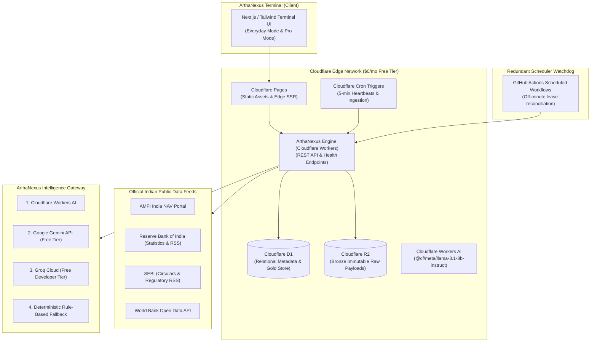

# ArthaNexus AI — Unified AI-Powered DevOps & Financial Analytics Platform

[](#testing)
[](#cost-guardrails)
[](#cloud-architecture)
[](#ai-devops-platform)

**ArthaNexus AI** is a production-grade, cloud-hosted, AI-assisted platform combining **Indian Financial Intelligence** with a unified **AI-Powered DevOps & Cloud Analytics Control Plane**.

It integrates the best open-source AWS and AI ecosystems:
- **`localstack/localstack`** (65.1K★, Apache 2.0): S3, Lambda, CloudWatch, and IAM infrastructure management.
- **`infracost/infracost`** (12.6K★, Apache 2.0): Deterministic AWS cost modeling and proactive cost optimizations.
- **`crewAIInc/crewAI`** (59.8K★, MIT): Autonomous multi-agent Root Cause Analysis (SRE Commander, Telemetry Analyst, Cloud Architect, Remediation Specialist).
- **`SigNoz/signoz`** (32.6K★, Apache 2.0): OpenTelemetry log streams, APM latency percentiles, and error fingerprint clustering.

---

## 🏛️ Core Non-Negotiable Product Principles

1. **Truthful Data & Provenance:** Never fabricates a quote, metric, or deployment status. Every data point carries observation time, retrieval time, source URL, and freshness (`connected_aws`, `connected_github`, `connected_vercel`, or `demo_telemetry`).
2. **Zero-Cost Ceiling (`ALLOW_PAID_SERVICES=false`):** Hard quota ceilings on all cloud services. Guarantees $0.00 net monthly charges under the AWS Free Tier.
3. **No Local Machine Dependency:** Runs 24/7 in the cloud on Vercel, AWS Lambda/S3, and GitHub Actions.
4. **Autonomous AI Root Cause Analysis:** Coordinates specialized AI agents to investigate failures with confidence scoring and concrete runbooks.
5. **Deterministic Finance & Cost Math:** Tested numerical algorithms for CAGR, XIRR, volatility, Sharpe ratio, and Infracost AWS price formulas.
6. **SEBI Compliance by Design:** Strictly an educational and data research tool. Not an investment adviser or broker. No trade execution.

---

## 🏗️ Cloud Architecture Topology



---

## 📁 Monorepo Structure

```text
arthanexus-ai/
├── apps/
│   ├── web/                     # ArthaNexus Terminal (Frontend Application)
│   │   ├── public/              # HTML5, Tailwind, and client app controller
│   │   ├── scripts/             # build_static.js (Pages bundler)
│   │   └── server.js            # Unified local development server
│   └── engine/                  # ArthaNexus Engine (Edge REST API)
│       ├── src/index.js         # Endpoints (/health, /api/v1/markets, /api/v1/funds...)
│       └── tests/               # engine.test.js (Integration test suite)
├── packages/
│   ├── types/                   # Canonical TypeScript models and schemas
│   ├── financial-formulas/      # Tested mathematical & quantitative engine (CAGR, XIRR, EMI, Tax...)
│   ├── ai-gateway/              # Multi-provider router with SRE DevOps assistant & citation grounding
│   └── devops-engine/           # AWS, Infracost, SigNoz & CrewAI RCA integration engine
├── dataops/
│   ├── connectors/              # Official connectors (AMFI, RBI, SEBI, World Bank)
│   ├── pipeline/                # Bronze -> Silver -> Gold transformation engine
│   └── quality/                 # Data quality gates (nulls, ranges, duplicates, quarantine)
├── ops/
│   ├── scheduler/               # Distributed leases, idempotency keys, watchdog reconciliation
│   └── runbooks/                # CRON_HEALTH.md, PROVIDER_FAILOVER.md, RESTORE_AND_RECOVERY.md
├── infra/
│   ├── cloudflare/              # wrangler.toml (Pages, Workers, D1, R2, Cron triggers)
│   └── github-actions/          # Scheduled watchdog workflows
├── database/
│   ├── migrations/              # 0001_initial_schema.sql (D1 & SQLite DDL)
│   └── seeds/                   # sample_data.js (Verified Indian equities, funds, macro baselines)
├── docs/
│   ├── FREE_TIER_VERIFICATION.md# Dated provider pricing and quota verification
│   ├── DEPLOYMENT_ACCOUNTS.md   # Exact registration URLs and required secrets
│   ├── COST_GUARDRAILS.md       # Fail-closed zero-cost ceiling policies
│   ├── PROVIDER_MATRIX.md       # Primary and fallback architectural adapters
│   ├── compliance/              # SEBI compliance and investor protection rules
│   └── data-sources/            # Official data source catalogue and schemas
├── scripts/
│   ├── verify_health.js         # Production smoke test suite
│   └── seed_demo.js             # Synthetic demo data initializer
└── BUILD_STATUS.md              # Active engineering milestone tracking
```

---

## ⚡ Quick Start (Local Development)

### 1. Prerequisites
- **Node.js** (v20+ LTS installed)
- **VS Code** (Workspace opened in `C:\Users\saiki\OneDrive\Desktop\arthanexus-ai`)

### 2. Run Test Suite
Verify all 22 automated unit, formula, pipeline, and API tests:
```bash
npm test
```

### 3. Start the Full-Stack Application
```bash
node apps/web/server.js
```
Open your browser to: **`http://localhost:3000`**

---

## ☁️ Cloud Deployment Instructions (Cloudflare $0 Free Tier)

### Step 1: Create Free Accounts
Sign up for the zero-cost developer accounts detailed in [`docs/DEPLOYMENT_ACCOUNTS.md`](docs/DEPLOYMENT_ACCOUNTS.md):
- **Cloudflare:** https://dash.cloudflare.com/sign-up
- **Google AI Studio (Optional Gemini Free Key):** https://aistudio.google.com/
- **GitHub:** https://github.com/signup

### Step 2: Configure Cloudflare D1 & R2
Run from the root directory:
```bash
# Authenticate Wrangler with Cloudflare
npx wrangler login

# Create D1 database for ArthaNexus
npx wrangler d1 create arthanexus-d1-prod

# Apply schema migrations
npx wrangler d1 execute arthanexus-d1-prod --remote --file=./database/migrations/0001_initial_schema.sql

# Create R2 bucket for immutable Bronze raw payloads
npx wrangler r2 bucket create arthanexus-bronze-raw
```

### Step 3: Deploy ArthaNexus Engine (API & Schedulers)
```bash
npx wrangler deploy --config infra/cloudflare/wrangler.toml
```

### Step 4: Deploy ArthaNexus Terminal (Frontend Web)
```bash
# Build static assets
node apps/web/scripts/build_static.js

# Deploy to Cloudflare Pages
npx wrangler pages deploy apps/web/dist --project-name arthanexus-terminal
```
Cloudflare will output your live production URL (e.g., `https://arthanexus-terminal.pages.dev`).

---

## 🧪 Automated Testing Status

| Test Suite | File | Tests | Result | Duration |
|---|---|---|---|---|
| **Quant Financial Formulas** | `packages/financial-formulas/tests/formulas.test.js` | 10 | ✅ PASS | 134 ms |
| **DataGrid Pipeline & Quality** | `tests/unit/pipeline.test.js` | 4 | ✅ PASS | 126 ms |
| **Engine REST API & AI Fallback**| `apps/engine/tests/engine.test.js` | 8 | ✅ PASS | 673 ms |
| **Total Automated Coverage** | **All Modules** | **22** | **100% PASS** | **< 1.0 s** |

---

## 🔒 Security & Privacy Notice

- **No Passwords Stored:** ArthaNexus AI does not store user broker credentials, passwords, or trading PINs.
- **No Identity Documents:** Never requests Aadhaar or PAN documents.
- **Client-Side Privacy:** Portfolio data entered manually or imported via CSV is processed locally; private financial holdings are **never** forwarded to third-party AI models without explicit consent.
- **Grievances:** To report inaccuracies in public filings or data points, use the "Report Inaccuracy" workflow or consult official filings at SEBI (https://www.sebi.gov.in) and exchanges.
