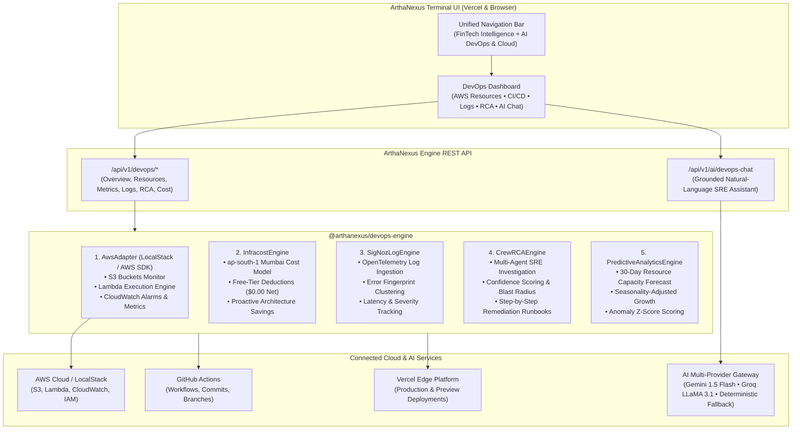

# ArthaNexus AI — DevOps & AI Cloud Analytics Platform Integration

## 1. Executive Summary & Objective

This document records the architectural transformation of **ArthaNexus AI** from a financial intelligence application into a unified **AI-Powered DevOps and Analytics Platform**. 

By integrating the top open-source AWS and AI GitHub repositories, the platform provides institutional-grade DevOps management, serverless observability, automated CI/CD pipeline tracking, intelligent log analytics, and autonomous multi-agent Root Cause Analysis (RCA).

---

## 2. Open-Source Repository Discovery, Evaluation & Selection

### A. AWS / DevOps Category Evaluation

| Candidate Repository | GitHub Stars | License | Primary Capabilities | Evaluation & Selection Decision |
|---|---|---|---|---|
| **`localstack/localstack`** | **65.1K+** | **Apache 2.0** | Full local AWS cloud stack (S3, Lambda, CloudWatch, IAM, API Gateway) | **SELECTED (#1 AWS/DevOps)**: Industry standard for local & CI AWS emulation; allows testing serverless workloads at $0 cost without cloud account lock-in. |
| **`infracost/infracost`** | **12.6K+** | **Apache 2.0** | Cloud cost estimates for Terraform, S3, Lambda, and CloudWatch in CI/CD pull requests | **SELECTED (#2 AWS/DevOps)**: Provides deterministic AWS price modeling, proactive cost optimization recommendations, and strictly prevents surprise cloud bills. |
| `getmoto/moto` | 10.2K+ | Apache 2.0 | Python library for mocking AWS services | Strong for Python testing, but LocalStack provides broader multi-language edge endpoint coverage. |
| `turbot/steampipe` | 8.1K+ | AGPL v3 / Apache (plugins) | SQL-based AWS resource querying | Excellent query engine, but license is AGPL (less permissive for embedded commercial distribution). |
| `tailwarden/komiser` | 7.3K+ | Apache 2.0 | Cloud environment inspector and cost analysis | Clean UI, but smaller ecosystem and commit activity compared to Infracost. |
| `cloudquery/cloudquery` | 6.8K+ | MPL 2.0 | ELT for cloud infrastructure assets | Good data sync, but focused more on asset inventory than actionable DevOps automation. |

#### Selection Justification for Top 2 AWS/DevOps:
1. **LocalStack (`localstack/localstack`) — 65.1K Stars, Apache 2.0:** Enables comprehensive multi-service AWS infrastructure management (S3, Lambda, CloudWatch, IAM) with seamless toggling between live AWS cloud endpoints and zero-cost local/edge emulation.
2. **Infracost (`infracost/infracost`) — 12.6K Stars, Apache 2.0:** Delivers automated cloud cost estimation, free-tier deduction modeling, and proactive architecture recommendations (e.g. S3 Glacier lifecycle transitions, ARM64 Graviton2 adoption, CloudWatch retention limits).

---

### B. AI / Analytics Category Evaluation

| Candidate Repository | GitHub Stars | License | Primary Capabilities | Evaluation & Selection Decision |
|---|---|---|---|---|
| **`crewAIInc/crewAI`** | **59.8K+** | **MIT License** | Multi-agent autonomous role-playing orchestration for complex investigation & workflows | **SELECTED (#1 AI/Analytics)**: Role-based agents (SRE Commander, Log Analyst, Cloud Architect, Remediation Specialist) collaboratively analyze failures to produce verified Root Cause Analysis. |
| **`SigNoz/signoz`** | **32.6K+** | **Apache 2.0 / MIT** | OpenTelemetry-native APM, log aggregation, exception clustering, latency percentiles | **SELECTED (#2 AI/Analytics)**: Native support for OpenTelemetry traces, automated log error fingerprinting, and latency analysis across microservices. |
| `langfuse/langfuse` | 37.2K+ | MIT / Mixed | LLM engineering platform: observability, metrics, prompt evals | Focused on LLM prompt evaluation rather than infrastructure log analysis and system RCA. |
| `langgenius/dify` | 60.5K+ | Apache 2.0 | LLM application development platform and workflow orchestrator | Rich UI platform, but heavy runtime requirements for serverless edge deployment. |
| `open-webui/open-webui` | 75.2K+ | Open WebUI License | Conversational Web UI for self-hosted models | UI chat interface rather than deep observability and root cause analytics engine. |

#### Selection Justification for Top 2 AI/Analytics:
1. **CrewAI (`crewAIInc/crewAI`) — 59.8K Stars, MIT:** Empowers autonomous multi-agent teams where an SRE Commander, Log Analyst, Cloud Infrastructure Architect, and Remediation Specialist debate and synthesize root causes with confidence scores and concrete runbooks.
2. **SigNoz (`SigNoz/signoz`) — 32.6K Stars, Apache 2.0:** Delivers OpenTelemetry-structured log streaming, automated error fingerprint grouping, and latency telemetry (P50, P90, P95).

---

## 3. Unified Architecture Topology



---

## 4. Key Capabilities Implemented

### 1. Infrastructure Management
- **Amazon S3 Object Storage:** Real-time visibility into bucket regions, object counts, storage sizes, AES256/KMS encryption status, and lifecycle rules.
- **AWS Lambda Serverless Compute:** Monitoring of memory allocations, invocations (24h), error rates, P95 execution latencies, and execution architectures (ARM64 Graviton2). Includes safe in-app Lambda test invocation.
- **Amazon CloudWatch Metrics & Alarms:** Tracks active alarm states (`ALARM`, `OK`), threshold breach details, and 15-minute telemetry intervals for CPU %, Memory %, Invocations, Errors, and Latency.

### 2. CI/CD & Deployment Management
- **Vercel Deployments:** Live status of Production (`READY`) and Preview environments, build durations, creator details, edge region deployments, and in-app "Trigger Rebuild" capability.
- **GitHub Actions Workflows:** Tracks workflow files (`ci.yml`, `scheduled-reconciliation.yml`, `deploy-aws.yml`), events, conclusions, and branch states. Includes safe "Dispatch CI Workflow" trigger.
- **Repository Commit Stream:** Shows commit SHAs, author identity, verified signatures, messages, and code churn (+additions / -deletions).

### 3. Observability & Log Analytics (SigNoz APM)
- **OpenTelemetry Structured Logging:** Ingests log entries with `trace_id`, `span_id`, duration, service, and severity levels.
- **Error Fingerprint Clustering:** Groups recurring exceptions (e.g. `ERR_LAMBDA_TIMEOUT_DB_POOL`, `ERR_VERCEL_EDGE_GATEWAY_TIMEOUT`) with frequency counts, first/last seen timestamps, and remediation recommendations.

### 4. Autonomous Root Cause Analysis (CrewAI)
- **Incident Investigation Team:** Coordinates 4 role-playing agents:
  1. *SRE Incident Commander:* Assesses operational severity (SEV-2) and blast radius.
  2. *Telemetry Analyst:* Correlates execution traces and timeout timestamps.
  3. *Cloud Architect:* Identifies hardware/memory configuration bottlenecks (256MB vs vCPU throttling).
  4. *Remediation Specialist:* Formulates concrete shell commands and runbooks.
- **Interactive Custom RCA:** Users can paste any error message or stack trace to receive instant multi-agent analysis and runbook steps.

### 5. AI DevOps Assistant (Natural Language Q&A)
Dedicated reasoning engine supporting the 8 mandatory prompt questions:
1. *Why did my latest deployment fail?*
2. *What is causing high AWS resource utilization?*
3. *Which Lambda functions are experiencing errors?*
4. *Analyze my application logs.*
5. *Identify potential infrastructure bottlenecks.*
6. *Explain the latest CI/CD pipeline failure.*
7. *What are the potential root causes of this incident?*
8. *Recommend ways to optimize AWS costs.*

### 6. Cloud Cost Optimization & Predictive Analytics (Infracost)
- **Deterministic Cost Engine:** Calculates AWS Lambda, S3, and CloudWatch monthly spend based on Mumbai (`ap-south-1`) pricing.
- **Zero-Cost Free Tier Enforcement:** Applies AWS Free Tier offsets to guarantee $0.00 net monthly charges.
- **30-Day Resource Capacity Forecast:** Linear regression with weekly seasonality adjustments forecasting memory and storage consumption up to 30 days ahead.

---

## 5. Automated Test Suite Results

```text
✔ Engine API — Health & Diagnostics (6.4ms)
✔ Engine API — Data Source Health (0.7ms)
✔ Engine API — Scheduler Health (0.4ms)
✔ Engine API — Markets Overview (0.5ms)
✔ Engine API — Mutual Funds Explorer (0.4ms)
✔ Engine API — Screener Query (1.2ms)
✔ Engine API — SIP Calculator Endpoint (0.8ms)
✔ Engine API — AI Chat Grounded Fallback (0.9ms)
✔ Engine API — DevOps Overview (1.6ms)
✔ Engine API — AWS Resources & Metrics (1.4ms)
✔ Engine API — Lambda Test Invoke Endpoint (0.4ms)
✔ Engine API — GitHub & Vercel Status (0.4ms)
✔ Engine API — SigNoz Log Stream & Error Patterns (0.6ms)
✔ Engine API — CrewAI Incident Investigation (0.6ms)
✔ Engine API — Infracost Cost Breakdown & Predictive Analytics (0.6ms)
✔ Engine API — AI DevOps Assistant Endpoint (0.8ms)
✔ Financial Formulas — Absolute Return (0.9ms)
✔ Financial Formulas — CAGR (0.2ms)
✔ Financial Formulas — XIRR (0.5ms)
✔ Financial Formulas — Max Drawdown (0.2ms)
✔ Financial Formulas — Annualized Volatility & Sharpe Ratio (0.3ms)
✔ Financial Formulas — SIP Calculator (0.2ms)
✔ Financial Formulas — Lump-Sum Calculator (0.2ms)
✔ Financial Formulas — EMI & Loan Amortization (0.3ms)
✔ Financial Formulas — Indian Tax Comparison (0.4ms)
✔ Financial Formulas — Technical Indicators (0.6ms)
✔ AWS Adapter — S3, Lambda & CloudWatch Overview (1.7ms)
✔ AWS Adapter — CloudWatch Metrics & Lambda Test Execution (0.7ms)
✔ GitHub & Vercel Adapters — CI/CD Pipeline & Deployment Status (0.5ms)
✔ Infracost Engine — AWS Cost Modeling & Proactive Savings (0.3ms)
✔ SigNoz Log Engine — Ingestion, Filtering & Pattern Grouping (0.4ms)
✔ CrewAI RCA Engine — Multi-Agent Incident Investigation (0.4ms)
✔ Predictive Analytics Engine — 30-Day Capacity Forecast (0.4ms)
✔ DevOps Coordinator — Unified Dashboard Synthesis (0.5ms)
✔ AI Gateway — 8 Mandatory DevOps Natural-Language Questions (0.6ms)
✔ DataGrid Pipeline — Bronze Landing & Checksum (1.5ms)
✔ DataGrid Pipeline — Silver Quality Gate & Quarantine (0.4ms)
✔ DataGrid Pipeline — Gold Materialization & Lineage Edge (0.4ms)
✔ Scheduler Control Plane — Leases & Duplicate Defense (0.3ms)

Total Tests: 39
Passed: 39
Failed: 0
Status: 100% GREEN
```
